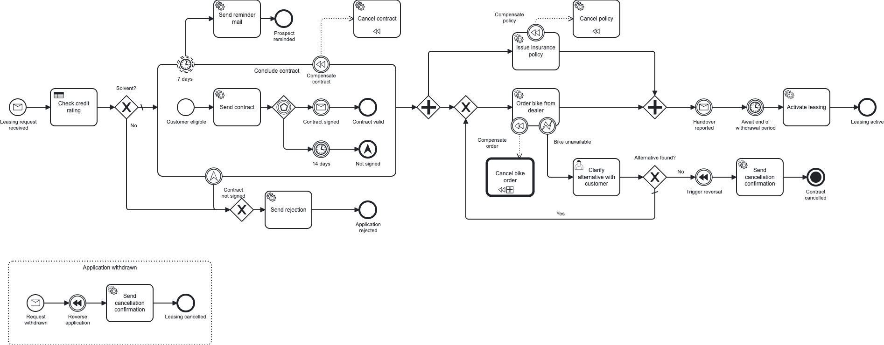

# Camunda 8 Bike-Leasing Blueprint

<!-- variant:blueprint -->
[](https://github.com/miragon-blueprints/zeebe-example/actions/workflows/pre-merge-kotlin-gradle.yml) [](https://github.com/miragon-blueprints/zeebe-example/actions/workflows/pre-merge-java-maven.yml) [](./LICENSE)
<!-- /variant:blueprint -->

A ready-to-fork starting point for automating a business process on [Camunda 8](https://camunda.com)
(Zeebe, self-managed) with Spring Boot — one complete, runnable, production-shaped BPMN service. It
targets an external Zeebe broker: each BPMN service task is handled by a Spring job worker rather than
an in-process engine. It is a work-in-progress solution template to build on, not a product that ships.

<!-- variant:blueprint -->
## Pick your stack

| | [`kotlin-gradle/`](kotlin-gradle/README.md) | [`java-maven/`](java-maven/README.md) |
|---|---|---|
| **Stack** | Kotlin 2.4 · Gradle | Java 21 · Maven |
| **Choose it when** | you are free to choose — **our recommendation for a modern stack** | Java + Maven is your team's or company's standard, or you are in a training |

Both run the same process behind the same REST contract; [turn the repo into a single-stack starter](docs/starter.md) with one command.
<!-- /variant:blueprint -->

## The process



**MiraVelo** is a (fictional) bike brand that sells on a leasing model. This service automates a
leasing application from the first request to an active lease and deliberately walks through the broad
palette of BPMN elements you meet in real processes: a message start event, service tasks (job workers)
and a DMN business-rule task, an embedded sub-process with an event-based gateway and a non-interrupting
reminder timer, a parallel fork/join, a user task with a Camunda Form (completable in the Tasklist or via
REST), compensation / SAGA handlers guarded by error and escalation boundary events, a call activity, a
message event sub-process (withdrawal) and a terminate end event.

## Quick start

Requirements: **JDK 21** and **Docker** (or Podman).

```bash
docker compose -f stack/docker-compose.yml up -d
# variant:kotlin-gradle
cd kotlin-gradle && ./gradlew :service:app:bootRun
# /variant:kotlin-gradle
# variant:java-maven
cd java-maven && ./mvnw -pl service/app -am spring-boot:run
# /variant:java-maven
```

| What | URL | Login |
|---|---|---|
| Operate / Tasklist | <http://localhost:8080> | demo / demo |
| Swagger UI | <http://localhost:8081/swagger-ui.html> | — |

Drive the whole process over REST with the [Bruno](bruno/README.md) scenarios: `cd bruno && npx --yes @usebruno/cli@4.0.0 run . --env local -r`.
Setup, ports, containers and the PR workflow are in [`CONTRIBUTING.md`](CONTRIBUTING.md).

## What's inside

| Path | Content |
|---|---|
| [`openapi/`](openapi/openapi.json) | the checked-in, drift-gated OpenAPI contract |
| [`bruno/`](bruno/README.md) | the REST scenarios, the two ways to complete a user task, the incident demo |
| [`stack/`](stack/docker-compose.yml) | the Camunda 8 self-managed dev stack and Postgres |
| [`docs/`](docs/README.md) | the Architecture Decision Records: why the repo is shaped this way |

## Contributing

Contributions are welcome — see [`CONTRIBUTING.md`](CONTRIBUTING.md) and use [Conventional Commits](https://www.conventionalcommits.org).

## License

Licensed under the [MIT License](./LICENSE).
